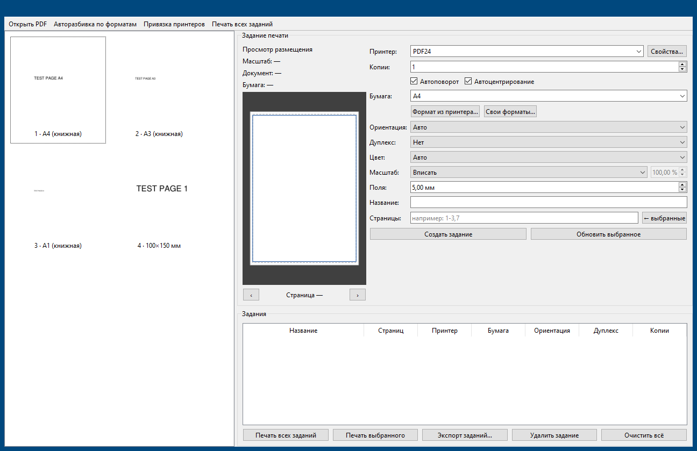

# PDF Print Router



Печать многоформатных PDF на разных принтерах под Windows.

Один многостраничный PDF со страницами разных форматов (A4, A3, A2/A1 для
плоттера, этикетки) раскладывается на задания: каждый формат — на свой
принтер, со своими настройками (ориентация, масштаб, дуплекс, копии, поля,
цвет). Интерфейс задания повторяет диалог печати Foxit Reader: живое превью
размещения страницы на листе + панель настроек.

## Возможности

- Просмотр PDF с миниатюрами и автоопределением формата каждой страницы.
- Авторазбивка страниц на задания по формату бумаги + ручные задания
  из выделенных страниц.
- Привязка форматов к принтерам (A4 → офисный, A3 → второй, A2/A1 → плоттер),
  сохраняется между запусками; поддерживается любое число форматов и
  произвольные размеры (плоттеры, рулоны, этикетки).
- Масштаб: «Вписать», «Заполнить», «100%», свой процент; автоповорот
  и автоцентрирование, поля в мм.
- «Свойства…» — родной диалог драйвера принтера; выбранные настройки
  подставляются в задание и сохраняются как личные умолчания.
- Печать всех подготовленных заданий одной кнопкой.
- Ориентация «Альбомная» печатается напрямую через Win32 GDI с явным
  DEVMODE — длинная сторона листа ложится поперёк рулона плоттера
  (проверено на HP DesignJet T520), независимо от умолчаний драйвера.
- Экспорт заданий в PDF + `print_manifest.json` для печати из командной
  строки (`print_windows.py`).

## Требования

- Windows 10/11.
- [SumatraPDF](https://www.sumatrapdfreader.org/download-free-pdf-viewer) 3.2+
  (используется для тихой печати на офисных принтерах).

## Сборка и запуск

Готовый exe (Python не нужен):

```
build.bat
```

Скрипт сам скачает Python (без прав администратора), поставит зависимости
и соберёт приложение в `dist\PDFPrintRouter\PDFPrintRouter.exe`.
Папку `dist\PDFPrintRouter` можно переносить куда угодно.

Запуск из исходников (нужен Python 3.10+):

```
run.bat
```

## Тесты

```
python tests\smoke_test.py test_mixed.pdf   # headless-проверки логики
python tests\test_gdi_e2e.py                # сквозной тест GDI-печати (PDFCreator)
```

## Структура

```
main.py            — точка входа
app/
  main_window.py   — интерфейс (PySide6)
  jobs.py          — сборка PDF заданий (масштаб, поворот, поля)
  printers.py      — принтеры, диалог свойств драйвера, печать через SumatraPDF
  gdi_print.py     — прямая печать через Win32 GDI с явным DEVMODE (плоттеры)
  pdf_document.py  — работа с PDF (PyMuPDF): миниатюры, форматы страниц
  settings.py      — настройки (%APPDATA%\PDFPrintRouter\settings.json)
tests/             — smoke- и сквозные тесты
```

Подробная инструкция — в [ИНСТРУКЦИЯ.txt](ИНСТРУКЦИЯ.txt).
